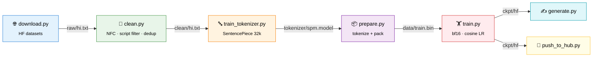

<div align="center">

# 🇮🇳 Indian-Language LLM from Scratch

### भारतीय भाषाओं के लिए एक छोटा भाषा मॉडल, शून्य से

**Train a Llama-style Hindi language model from scratch on a single 6 GB consumer GPU.**

[](https://www.python.org/)
[](https://pytorch.org/)
[](https://huggingface.co/docs/transformers)
[](https://docs.astral.sh/uv/)

[](#-model-configs)
[](#-model-configs)
[](#-design-choices)
[](#-roadmap)
[](https://github.com/ashishpatel26/Indian-Language-llm-model/stargazers)

[**Quickstart**](#-quickstart) · [**Pipeline**](#-pipeline) · [**Configs**](#-model-configs) · [**Design**](#-design-choices) · [**Roadmap**](#-roadmap) · [**Full Plan**](PLAN.md)

</div>

---

## ✨ Highlights

<table>
<tr>
<td width="50%" valign="top">

### 🧠 Real pretraining, small scale
A Llama architecture (RoPE · SwiGLU · RMSNorm · GQA · tied embeddings) trained **from random weights**. It uses no pretrained checkpoints and no `Trainer` abstraction.

</td>
<td width="50%" valign="top">

### 💻 Runs on a laptop GPU
The whole pipeline is tuned for **6 GB VRAM**: bf16, gradient checkpointing, optional 8-bit AdamW and memmapped data.

</td>
</tr>
<tr>
<td width="50%" valign="top">

### 🔤 Indic-first tokenizer
A **SentencePiece Unigram** tokenizer with byte fallback avoids the 3-bytes-per-character overhead that byte-level BPE has on Devanagari.

</td>
<td width="50%" valign="top">

### 🌏 Multilingual-ready
Language tags for **11 Indian languages** are reserved from day one. To add a language, you re-run the same pipeline.

</td>
</tr>
</table>

<div align="center">

| हिन्दी | मराठी | नेपाली | বাংলা | தமிழ் | తెలుగు | ગુજરાતી | ಕನ್ನಡ | മലയാളം | ਪੰਜਾਬੀ | ଓଡ଼ିଆ |
|:---:|:---:|:---:|:---:|:---:|:---:|:---:|:---:|:---:|:---:|:---:|
| `<hi>` ✅ | `<mr>` | `<ne>` | `<bn>` | `<ta>` | `<te>` | `<gu>` | `<kn>` | `<ml>` | `<pa>` | `<or>` |

<sub>✅ = training now · others = tags reserved, planned</sub>

</div>

> [!IMPORTANT]
> **Set expectations.** A model with 42M–110M parameters learns **fluent, grammatical Hindi** in a news or encyclopedic style. It will **not** know facts reliably or reason. For a useful assistant, QLoRA fine-tune a 1–3B open model instead ([details](PLAN.md#6-realistic-expectations)).

---

## 🔄 Pipeline



---

## 🚀 Quickstart

> **Requires:** Python 3.12 · [uv](https://docs.astral.sh/uv/) · NVIDIA GPU with CUDA 12.x drivers

```bash
git clone https://github.com/ashishpatel26/Indian-Language-llm-model.git
cd Indian-Language-llm-model
uv sync                      # torch (cu126) + deps
uv sync --extra opt          # optional: bitsandbytes 8-bit AdamW
```

### 1️⃣ Download data

```bash
uv run python scripts/download.py hi                  # Hindi Wikipedia (~160k articles)
SOURCE=sangraha uv run python scripts/download.py hi  # larger: AI4Bharat Sangraha (needs `hf auth login`)
```

### 2️⃣ Clean

```bash
uv run python scripts/clean.py hi raw/hi.txt clean/hi.txt
```

<sub>Keeps lines that are ≥ 20 characters and ≥ 80% target script (Devanagari for `hi`). Also NFC-normalizes, strips URLs and removes exact duplicates.</sub>

### 3️⃣ Train the tokenizer

```bash
uv run python scripts/train_tokenizer.py clean/hi.txt 32000
```

> [!TIP]
> The script prints **fertility** (tokens per word). Healthy Hindi is about **1.3–1.8**. Above 3 means vocab or coverage is too small.

### 4️⃣ Tokenize & pack

```bash
uv run python scripts/prepare.py clean/hi.txt hi
```

<sub>Each document becomes <code>&lt;hi&gt; … &lt;/s&gt;</code> and is appended to one flat <code>uint16</code> stream. Every 200th line goes to validation. There's no padding, and training reads the stream through <code>np.memmap</code>.</sub>

### 5️⃣ Train

<table>
<tr><th>bash</th><th>PowerShell</th></tr>
<tr>
<td>

```bash
SIZE=small MAX_STEPS=12000 \
  uv run python scripts/train.py
```

</td>
<td>

```powershell
$env:SIZE="small"; $env:MAX_STEPS="12000"
uv run python scripts/train.py
```

</td>
</tr>
</table>

| Env var | Default | Meaning |
|:--|:--|:--|
| `SIZE` | `small` | `tiny` · `small` · `main` |
| `MAX_STEPS` | `12000` | optimizer steps (cosine LR, warmup = min(1000, 10%)) |
| `MICRO_BS` / `GRAD_ACC` | per size | micro-batch size × gradient accumulation |
| `OUT` | `ckpt` | checkpoint directory |

> [!NOTE]
> Training **auto-resumes** from `ckpt/state.pt`. Run `SIZE=tiny` for a few hundred steps first to smoke-test the pipeline.

<details>
<summary><b>💥 Out of memory?</b></summary>

<br>

Halve `MICRO_BS` and double `GRAD_ACC`, which keeps the same effective batch.

</details>

### 6️⃣ Generate

```bash
uv run python scripts/generate.py "भारत की राजधानी"   # single prompt
uv run python scripts/generate.py                    # interactive mode
```

### 7️⃣ Publish (optional)

```bash
uv run hf auth login
uv run python scripts/push_to_hub.py <user>/<repo> [ckpt] [--private]
```

<sub>Uploads the weights, the SentencePiece model and an auto-generated model card.</sub>

<details>
<summary><b>⚡ GPU speed check</b></summary>

<br>

```bash
uv run python scripts/bench.py 0 8   # grad checkpointing off, batch 8
```

A healthy RTX 3060 Laptop reaches **more than 15k tokens/s** on the `small` config.

</details>

---

## 📐 Model configs

<div align="center">

| | 🐣 tiny | 🐥 small | 🦅 main |
|:--|:--:|:--:|:--:|
| hidden | 256 | 512 | 768 |
| layers | 4 | 8 | 12 |
| heads / kv-heads | 4 / 4 | 8 / 8 | 12 / 4 (GQA) |
| FFN (SwiGLU) | 704 | 1408 | 2048 |
| context | 256 | 512 | 1024 |
| **params** | smoke test | **~42M** | **~110M** |
| token budget (~20 tok/param) | — | ~0.8B | ~2B |

</div>

**📉 Healthy loss curve** (Hindi, 32k vocab):

```
step 0      ████████████████████  ~10.4
step ~1k    █████████             < 5.0
end         ██████                3.0 – 3.5  (val)
```

<sub>If val loss rises while train loss keeps falling, you are overfitting: you need more data, not more steps.</sub>

---

## 🧩 Design choices

| ❌ Common approach | ✅ This repo | Why |
|:--|:--|:--|
| Pad / truncate each line | **Packed token stream** | No compute wasted on padding, and the model sees real EOS tokens |
| Byte-level BPE | **SentencePiece Unigram** + byte fallback | Indic characters are 3 UTF-8 bytes each. Unigram keeps fertility low and never emits `<unk>` |
| fp16 | **bf16** (fp16 + GradScaler as fallback) | No loss spikes or NaNs in scratch training |
| Train N epochs | **Token budget** (~20 tok/param) | One pass over more data beats repeating less |
| Equal language mix | **Temperature sampling** (α ≈ 0.3) | Rich languages aren't starved and small ones don't overfit |

<sub>Full rationale, the multilingual roadmap and instruction-tuning notes are in <a href="PLAN.md">PLAN.md</a>.</sub>

---

## 📁 Project layout

```
Indian-Language-llm-model/
├── 📄 PLAN.md                  full design doc & roadmap
├── ⚙️ pyproject.toml           uv project (torch cu126)
└── 📂 scripts/
    ├── download.py             HF datasets → raw/<lang>.txt
    ├── clean.py                normalize · filter · dedup
    ├── train_tokenizer.py      SentencePiece Unigram
    ├── prepare.py              tokenize + pack → data/*.bin
    ├── train.py                pretraining loop
    ├── generate.py             sampling
    ├── bench.py                GPU throughput check
    └── push_to_hub.py          publish to Hugging Face
```

<sub><code>raw/</code> · <code>clean/</code> · <code>data/</code> · <code>tokenizer/</code> · <code>ckpt*/</code> are generated locally and gitignored.</sub>

---

## 🗺️ Roadmap

- [x] Hindi Wikipedia downloaded and cleaned
- [x] 32k SentencePiece tokenizer trained
- [x] ~56M Hindi tokens packed
- [ ] 🐥 `small` pretraining run
- [ ] Larger corpus (Sangraha / IndicCorp) + 🦅 `main` run
- [ ] Per-language eval (val perplexity, fertility)
- [ ] Multilingual: Devanagari family → Dravidian → Eastern
- [ ] Optional chat SFT (Aya / IndicInstruct)

---

## 📚 Data sources

| Dataset | Languages | Notes |
|:--|:--|:--|
| [Wikipedia](https://huggingface.co/datasets/wikimedia/wikipedia) | all | Small, high quality, the default |
| [AI4Bharat Sangraha](https://huggingface.co/datasets/ai4bharat/sangraha) | 22 Indic | Verified web, PDF and synthetic text |
| [IndicCorp v2](https://github.com/AI4Bharat/IndicBERT) | 22 Indic + en | Large, clean news corpus |

> [!CAUTION]
> Check each dataset's license before you redistribute a trained model.

---

<div align="center">

**If this helped you, consider giving it a ⭐**

<sub>Built with PyTorch · 🤗 Transformers · SentencePiece</sub>

</div>
