<div align="center">

# 🪔 Ramayana LLM: Indian-Language Models from Scratch

### भारतीय भाषाओं के लिए छोटे भाषा मॉडल, शून्य से

**Train Llama-style Hindi language models from random weights on a single 6 GB laptop GPU, then instruction-tune them to answer questions.**

[](https://www.python.org/)
[](https://pytorch.org/)
[](https://huggingface.co/docs/transformers)
[](https://docs.astral.sh/uv/)

[](https://huggingface.co/collections/ashishpatel26/ramayana-series-indic-llms-from-scratch-6af7e87d0a621b28fed81feb)
[](https://ashishpatel26.github.io/ramayana-llm/)
[](#-model-configs)
[](#-design-choices)
[](LICENSE)
[](https://github.com/ashishpatel26/Indian-Language-llm-model/stargazers)

[**Models**](#-the-ramayana-series) · [**Results**](#-results) · [**Try it**](#-try-the-models) · [**Quickstart**](#-quickstart) · [**Design**](#-design-choices) · [**Roadmap**](#%EF%B8%8F-roadmap) · [**Website**](https://ashishpatel26.github.io/ramayana-llm/) · [**Full Plan**](PLAN.md)

</div>

---

## 🏹 The Ramayana Series

Every model in this repo was trained **from random initialisation**, not fine-tuned from someone else's checkpoint, and each is named after a figure from the Ramayana whose role matches what the model does.

| | Model | Params | What it does | Status |
|:--:|:--|:--:|:--|:--:|
|  | [**Jatayu-hi-11M**](https://huggingface.co/ashishpatel26/jatayu-hi-11m) | 11.4M | Smoke-test baseline. Grammatical Hindi, invented facts. | ✅ released |
|  | [**Hanuman-hi-42M**](https://huggingface.co/ashishpatel26/hanuman-hi-42m) | 42.1M | Hindi **base model**: fluent, encyclopaedic text continuation. | ✅ released |
|  | [**Angad-hi-42M**](https://huggingface.co/ashishpatel26/angad-hi-42m) | 42.1M | Hanuman **instruction-tuned**; answers Hindi questions. | ✅ released |
|  | Jambavan | ~110M | Bigger base model on 1–2B Sangraha tokens, for better facts. | ⏳ planned |
|  | Setu | — | One multilingual model across Indian languages. | ⏳ planned |

🌐 **Website:** https://ashishpatel26.github.io/ramayana-llm/ · 🤗 **Collection:** [Ramayana Series](https://huggingface.co/collections/ashishpatel26/ramayana-series-indic-llms-from-scratch-6af7e87d0a621b28fed81feb)

> [!IMPORTANT]
> **Set expectations.** Models with 11M–42M parameters learn **fluent, grammatical Hindi** and, after SFT, the **shape of an answer**. They do **not** know facts reliably: Angad will tell you the capital of India is Chennai, confidently. For a useful assistant, QLoRA fine-tune a 1–3B open model instead ([details](PLAN.md#6-realistic-expectations)).

---

## 📊 Results

All numbers were measured on held-out data the models never trained on.

**Pretraining** (Hindi Wikipedia validation, 100 batches):

| Model | Params | Tokens seen | Val loss | Perplexity |
|:--|:--:|:--:|:--:|:--:|
| Jatayu-hi-11M | 11.4M | 33M | 4.68 | 107.5 |
| **Hanuman-hi-42M** | 42.1M | 229M | **3.84** | **46.4** |

**Instruction tuning** (380 held-out Hindi Q&A pairs, loss on answer tokens only):

| Model | Answer loss | Answer perplexity |
|:--|:--:|:--:|
| Hanuman-hi-42M (base, same prompt) | 4.07 | 58.4 |
| **Angad-hi-42M** (SFT) | **2.83** | **16.9** |

**What Angad says** (unedited):

| प्रश्न | उत्तर | Verdict |
|:--|:--|:--|
| स्वस्थ रहने के तीन उपाय बताइए। | 1. बेहतर भोजन करें … 3. नियमित रूप से व्यायाम करें … | ✅ follows the instruction (skips 2) |
| होली का त्योहार क्यों मनाया जाता है? | होली एक लोकप्रिय त्योहार है… हर साल अक्टूबर के… | ⚠️ fluent, wrong month |
| भारत की राजधानी क्या है? | चेन्नई | ❌ right format, wrong fact |

---

## 💬 Try the models

```bash
uv run python scripts/generate.py "हिमालय पर्वत" ckpt_small                       # Hanuman: continue text
CHAT=1 uv run python scripts/generate.py "होली क्यों मनाई जाती है?" ckpt_angad     # Angad: answer a question
CHAT=1 uv run python scripts/generate.py "" ckpt_angad                            # interactive chat
```

Or straight from the Hub:

```python
import torch, sentencepiece as spm
from huggingface_hub import hf_hub_download
from transformers import LlamaForCausalLM

repo = "ashishpatel26/angad-hi-42m"
model = LlamaForCausalLM.from_pretrained(repo)
sp = spm.SentencePieceProcessor(model_file=hf_hub_download(repo, "spm.model"))

x = torch.tensor([sp.encode("<hi>प्रश्न: स्वस्थ रहने के तीन उपाय बताइए।\nउत्तर: ")])
y = model.generate(x, max_new_tokens=150, do_sample=True, temperature=0.7, top_p=0.9,
                   repetition_penalty=1.15, eos_token_id=sp.eos_id(), pad_token_id=sp.pad_id())
print(sp.decode(y[0, x.shape[1]:].tolist()))
```

> [!NOTE]
> Base models (Jatayu, Hanuman) take a prompt that starts with `<hi>`. Angad needs the exact template `<hi>प्रश्न: …\nउत्तर: `.

---

## ✨ Highlights

<table>
<tr>
<td width="50%" valign="top">

### 🧠 Real pretraining, small scale
A Llama architecture (RoPE · SwiGLU · RMSNorm · GQA · tied embeddings) trained **from random weights**. It uses no pretrained checkpoints and no `Trainer` abstraction.

</td>
<td width="50%" valign="top">

### 💻 Runs on a laptop GPU
The whole pipeline is tuned for **6 GB VRAM**: bf16, gradient checkpointing, optional 8-bit AdamW, memmapped data, and **crash-safe atomic checkpoints** with auto-resume.

</td>
</tr>
<tr>
<td width="50%" valign="top">

### 🔤 Indic-first tokenizer
A **SentencePiece Unigram** tokenizer with byte fallback, at **~1.1 tokens per Hindi word**. It avoids the 3-bytes-per-character overhead that byte-level BPE has on Devanagari.

</td>
<td width="50%" valign="top">

### 💬 Pretrain → SFT, end to end
Instruction tuning uses **answer-only loss** and length-bucketed batches, turning the base model into a Q&A model in **about an hour**.

</td>
</tr>
</table>

<div align="center">

| हिन्दी | मराठी | नेपाली | বাংলা | தமிழ் | తెలుగు | ગુજરાતી | ಕನ್ನಡ | മലയാളം | ਪੰਜਾਬੀ | ଓଡ଼ିଆ |
|:---:|:---:|:---:|:---:|:---:|:---:|:---:|:---:|:---:|:---:|:---:|
| `<hi>` ✅ | `<mr>` | `<ne>` | `<bn>` | `<ta>` | `<te>` | `<gu>` | `<kn>` | `<ml>` | `<pa>` | `<or>` |

<sub>✅ = trained · others = tags reserved for Setu (multilingual)</sub>

</div>

---

## 🔄 Pipeline

```mermaid
flowchart LR
    A["🌐 download.py<br/><sub>HF datasets</sub>"] -->|raw/hi.txt| B["🧹 clean.py<br/><sub>NFC · script filter · dedup</sub>"]
    B -->|clean/hi.txt| C["🔤 train_tokenizer.py<br/><sub>SentencePiece 32k</sub>"]
    C -->|tokenizer/spm.model| D["📦 prepare.py<br/><sub>tokenize + pack</sub>"]
    D -->|data/train.bin| E["🏋️ train.py<br/><sub>pretrain · bf16 · cosine LR</sub>"]
    E -->|ckpt_small/hf| H["💬 sft.py<br/><sub>instruction tuning</sub>"]
    S["📝 sft_data.py<br/><sub>Hindi Q&A · filter · dedup</sub>"] -->|data/sft_*.jsonl| H
    E -->|base model| F["✍️ generate.py"]
    H -->|ckpt_angad/hf| F
    H --> G["🤗 push_to_hub.py"]

    style A fill:#e3f2fd,stroke:#1976d2,color:#000
    style B fill:#e8f5e9,stroke:#388e3c,color:#000
    style C fill:#fff3e0,stroke:#f57c00,color:#000
    style D fill:#f3e5f5,stroke:#7b1fa2,color:#000
    style E fill:#ffebee,stroke:#d32f2f,color:#000
    style S fill:#e8eaf6,stroke:#3949ab,color:#000
    style H fill:#fce4ec,stroke:#c2185b,color:#000
    style F fill:#e0f7fa,stroke:#0097a7,color:#000
    style G fill:#fffde7,stroke:#fbc02d,color:#000
```



---

## 🚀 Quickstart

> **Requires:** Python 3.12 · [uv](https://docs.astral.sh/uv/) · NVIDIA GPU with CUDA 12.x drivers

```bash
git clone https://github.com/ashishpatel26/Indian-Language-llm-model.git
cd Indian-Language-llm-model
uv sync                      # torch (cu126) + deps
uv sync --extra opt          # optional: bitsandbytes 8-bit AdamW
```

### 1️⃣ Download data

```bash
uv run python scripts/download.py hi                  # Hindi Wikipedia (~160k articles)
SOURCE=sangraha uv run python scripts/download.py hi  # larger: AI4Bharat Sangraha (needs `hf auth login`)
```

### 2️⃣ Clean

```bash
uv run python scripts/clean.py hi raw/hi.txt clean/hi.txt
```

<sub>Keeps lines that are ≥ 20 characters and ≥ 80% target script (Devanagari for `hi`). Also NFC-normalizes, strips URLs and removes exact duplicates.</sub>

### 3️⃣ Train the tokenizer

```bash
uv run python scripts/train_tokenizer.py clean/hi.txt 32000
```

> [!TIP]
> The script prints **fertility** (tokens per word). Ours is **~1.1** on Hindi Wikipedia; healthy is about 1.1–1.8. Above 3 means vocab or coverage is too small.

### 4️⃣ Tokenize & pack

```bash
uv run python scripts/prepare.py clean/hi.txt hi
```

<sub>Each document becomes <code>&lt;hi&gt; … &lt;/s&gt;</code> and is appended to one flat <code>uint16</code> stream. Every 200th line goes to validation. There's no padding, and training reads the stream through <code>np.memmap</code>.</sub>

### 5️⃣ Pretrain

<table>
<tr><th>bash</th><th>PowerShell</th></tr>
<tr>
<td>

```bash
SIZE=small MAX_STEPS=3500 CKPT=0 \
  OUT=ckpt_small \
  uv run python scripts/train.py
```

</td>
<td>

```powershell
$env:SIZE="small"; $env:MAX_STEPS="3500"
$env:CKPT="0"; $env:OUT="ckpt_small"
uv run python scripts/train.py
```

</td>
</tr>
</table>

| Env var | Default | Meaning |
|:--|:--|:--|
| `SIZE` | `small` | `tiny` · `small` · `main` |
| `MAX_STEPS` | `12000` | optimizer steps (cosine LR, warmup = min(1000, 10%)) |
| `MICRO_BS` / `GRAD_ACC` | per size | micro-batch size × gradient accumulation |
| `CKPT` | `1` | gradient checkpointing (`0` = faster, uses more VRAM) |
| `EVAL_EVERY` | `500` | steps between val loss, sample and checkpoint |
| `OUT` | `ckpt` | checkpoint directory |

> [!NOTE]
> Training **auto-resumes** from `OUT/state.pt`. Checkpoints are written atomically (temp file + rename), so a crash or Ctrl+C never corrupts the last good one. Press Ctrl+C **once** to save and exit.

<details>
<summary><b>💥 Out of memory?</b></summary>

<br>

Halve `MICRO_BS` and double `GRAD_ACC`, which keeps the same effective batch. Or set `CKPT=1`.

</details>

### 6️⃣ Instruction-tune (SFT)

```bash
uv run python scripts/sft_data.py                                    # build data/sft_{train,val}.jsonl
BASE=ckpt_small OUT=ckpt_angad EPOCHS=2 uv run python scripts/sft.py   # ~1 hour on RTX 3060
```

<sub>Pulls Hindi Q&A from <a href="https://huggingface.co/datasets/mashriram/AI4Bharat-Indic-Languages-and-Cultures">mashriram/AI4Bharat-Indic-Languages-and-Cultures</a>, keeps only Devanagari Hindi (drops romanised, Marathi, Santali and Sanskrit rows), dedups to 42k pairs. Template: <code>&lt;hi&gt;प्रश्न: {q}\nउत्तर: {a}&lt;/s&gt;</code>; loss is on answer tokens only.</sub>

### 7️⃣ Generate

```bash
uv run python scripts/generate.py "भारत की राजधानी" ckpt_small    # continue text
CHAT=1 uv run python scripts/generate.py "" ckpt_angad            # interactive Q&A
```

### 8️⃣ Publish (optional)

```bash
uv run hf auth login
uv run python scripts/push_to_hub.py <user>/<repo> [ckpt] [--private]
```

<sub>Uploads the weights, the SentencePiece model and a model card.</sub>

<details>
<summary><b>⚡ GPU speed check</b></summary>

<br>

```bash
uv run python scripts/bench.py 0 8   # grad checkpointing off, batch 8
```

A healthy RTX 3060 Laptop reaches **more than 10–15k tokens/s** on the `small` config. If you see ~4k, the laptop is power-throttled: switch the vendor tool (e.g. PredatorSense) to Turbo/Performance and plug in the charger.

</details>

---

## 📐 Model configs

<div align="center">

| | 🐣 tiny (Jatayu) | 🐥 small (Hanuman / Angad) | 🦅 main (Jambavan) |
|:--|:--:|:--:|:--:|
| hidden | 256 | 512 | 768 |
| layers | 4 | 8 | 12 |
| heads / kv-heads | 4 / 4 | 8 / 8 | 12 / 4 (GQA) |
| FFN (SwiGLU) | 704 | 1408 | 2048 |
| context | 256 | 512 | 1024 |
| **params** | **11.4M** | **42.1M** | **~110M** |
| tokens/step | 16k | 65k | 131k |
| trained | 2,000 steps · ~1.2 h | 3,500 steps + SFT | planned |

</div>

**📉 Loss curve we actually got** (Hanuman, Hindi, 32k vocab):

```
step 0      ████████████████████  ~10.4
step 40     ██████████████        7.1
end (3500)  ███████               3.84  (val)
```

<sub>If val loss rises while train loss keeps falling, you are overfitting: you need more data, not more steps.</sub>

---

## 🧩 Design choices

| ❌ Common approach | ✅ This repo | Why |
|:--|:--|:--|
| Pad / truncate each line | **Packed token stream** | No compute wasted on padding, and the model sees real EOS tokens |
| Byte-level BPE | **SentencePiece Unigram** + byte fallback | Indic characters are 3 UTF-8 bytes each. Unigram keeps fertility low and never emits `<unk>` |
| fp16 | **bf16** (fp16 + GradScaler as fallback) | No loss spikes or NaNs in scratch training |
| Train N epochs | **Token budget** (~20 tok/param) | One pass over more data beats repeating less |
| SFT loss on whole sequence | **Answer-only loss** (prompt masked) | The model learns to answer, not to repeat questions |
| `torch.save` straight to file | **Atomic save** (tmp + `os.replace`) | A kill mid-save can't corrupt the checkpoint |
| Equal language mix | **Temperature sampling** (α ≈ 0.3) | Rich languages aren't starved and small ones don't overfit |

<sub>Full rationale, the multilingual roadmap and instruction-tuning notes are in <a href="PLAN.md">PLAN.md</a>.</sub>

---

## 📁 Project layout

```
Indian-Language-llm-model/
├── 📄 PLAN.md                  full design doc & roadmap
├── 📄 LICENSE                  Apache-2.0
├── ⚙️ pyproject.toml           uv project (torch cu126)
└── 📂 scripts/
    ├── download.py             HF datasets → raw/<lang>.txt
    ├── clean.py                normalize · filter · dedup
    ├── train_tokenizer.py      SentencePiece Unigram
    ├── prepare.py              tokenize + pack → data/*.bin
    ├── train.py                pretraining loop (atomic checkpoints, resume)
    ├── sft_data.py             Hindi Q&A → data/sft_{train,val}.jsonl
    ├── sft.py                  instruction tuning (answer-only loss)
    ├── generate.py             sampling · CHAT=1 for SFT models
    ├── bench.py                GPU throughput check
    └── push_to_hub.py          publish to Hugging Face
```

<sub><code>raw/</code> · <code>clean/</code> · <code>data/</code> · <code>tokenizer/</code> · <code>ckpt*/</code> are generated locally and gitignored.</sub>

---

## 🗺️ Roadmap

- [x] Hindi Wikipedia downloaded and cleaned (948k lines)
- [x] 32k SentencePiece tokenizer trained (~1.1 tokens/word)
- [x] ~56M Hindi tokens packed
- [x] 🐣 **Jatayu-hi-11M**: smoke-test run, released
- [x] 🐥 **Hanuman-hi-42M**: base model, released
- [x] 💬 **Angad-hi-42M**: Hindi instruction tuning, released
- [x] Project website + Hugging Face collection
- [ ] 🦅 **Jambavan** (~110M) on AI4Bharat Sangraha (1–2B tokens)
- [ ] Angad v2: SFT on Jambavan with native (non-translated) Hindi instructions
- [ ] Benchmarks: IndicGLUE / IndicXNLI / IndicQA
- [ ] 🌉 **Setu**: multilingual (Devanagari family → Dravidian → Eastern)

---

## 📚 Data sources

| Dataset | Used for | Languages | Notes |
|:--|:--|:--|:--|
| [Wikipedia](https://huggingface.co/datasets/wikimedia/wikipedia) `20231101.hi` | pretraining (all released models) | all | Small, high quality, CC BY-SA |
| [mashriram/AI4Bharat-Indic-Languages-and-Cultures](https://huggingface.co/datasets/mashriram/AI4Bharat-Indic-Languages-and-Cultures) | SFT (Angad) | Indic | Machine-translated instructions; no stated licence |
| [AI4Bharat Sangraha](https://huggingface.co/datasets/ai4bharat/sangraha) | planned (Jambavan) | 22 Indic | Verified web, PDF and synthetic text |
| [IndicCorp v2](https://github.com/AI4Bharat/IndicBERT) | planned | 22 Indic + en | Large, clean news corpus |

> [!CAUTION]
> Check each dataset's licence before you redistribute a trained model. The SFT dataset has no licence card; treat Angad as research-only until upstream terms are confirmed.

---

## 📜 License

Code in this repository is released under the [Apache License 2.0](LICENSE). Released model weights are Apache-2.0 as well, subject to the terms of their training data (see above).

---

<div align="center">

**If this helped you, consider giving it a ⭐**

<sub>Built with PyTorch · 🤗 Transformers · SentencePiece · on one RTX 3060 Laptop</sub>

<sub class="hi">॥ जय श्री राम ॥</sub>

</div>
